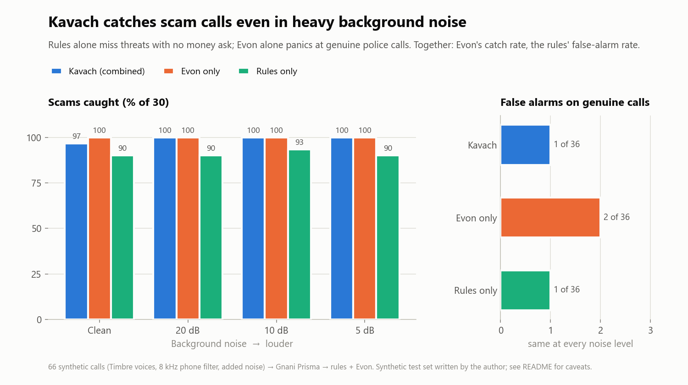

# 🛡️ Kavach: AI Scam-Call Shield

> "My mom almost fell for a digital-arrest call, so I built an AI that listens to the call and warns her in Hindi."

Kavach listens to a suspicious phone call on speaker and warns an elderly parent **out loud, in their own language**, before they share an OTP or send money. It also sends their son or daughter a Telegram alert with the scam type, risk score and reasons.

Built on Gnani AI's **Prisma** (speech to text), **Evon** (reasoning) and **Timbre** (text to speech).

> Kavach is an aid, not a guarantee. To report fraud, call the national cybercrime helpline **1930** or visit cybercrime.gov.in.

## Three ways to use it (all free)

| Way | Where it runs | When it warns |
|---|---|---|
| **Live listen** | Kavach installed as an app on a spare phone or tablet near the parent. Put the call on speaker and tap **सुनो**. (A phone can't listen to its own calls: Android silences other apps' mics during a call.) | **During** the call: a spoken Hindi warning, a red screen, and a family alert |
| **Auto-check recordings** | The parent's own phone records calls automatically, and a free automation app (MacroDroid) sends each recording to Kavach. Setup: [docs/auto-check-recordings.md](docs/auto-check-recordings.md) | **Right after** the call: a family alert, plus a Hindi notification on the phone |
| **Telegram bot** | Anyone forwards a recording or voice note to the bot | After the call: a verdict and a spoken warning |

Joining the call itself on any phone, even a keypad phone ("add Kavach to the call"), would need a paid
telephony number such as Exotel or Twilio. That's left as future work.

## How it works

```
 Mode A: browser mic (4 s chunks, WebSocket)      Mode B: Telegram voice note / recording
                    \                                  /
                     +----> Prisma (speech to text) <-+
                                    |
                     running transcript of the whole call
                                    |
          +-------------------------+--------------------------+
          | Layer 1: rules.py (instant, every chunk)           |
          | Layer 2: Evon judge (every ~10 s, in background)   |
          |   red needs one layer sure + the other suspicious  |
          +-------------------------+--------------------------+
                                    |
          risk >= 70: red screen + cached Timbre warning + guardian Telegram alert
          risk 40-69: "be careful" prompt       below 40: keep listening
```

- **Rule layer** (`app/rules.py`): Hindi, Hinglish and English phrases, each tagged as a *pretext* (police, bank, parcel, relative, prize), an *ask* (OTP, PIN, money, app install, link) or *pressure* (secrecy, urgency). A pretext plus an ask in the same call earns a bonus. A single red flag is capped below the caution line, to avoid false alarms.
- **Evon layer** (`app/evon_judge.py`): sends the full transcript with a strict JSON prompt, thinking mode off, and the output constrained to a JSON schema. It answers in 2–3 s on Kaggle T4s. On a timeout it returns nothing, and the rules carry on, so a slow Evon never blocks the warning. It is re-asked immediately when the rule score jumps.
- **How the layers combine** (`combine()` in `app/pipeline.py`): the red alarm needs one layer to be sure (≥70) and the other at least suspicious (≥40). If they disagree, the parent gets the orange "be careful" prompt instead. Until Evon has answered, the rules decide alone. This came from testing, where each layer made a mistake the other caught:

  | Genuine call | Rules | Evon | Kavach |
  |---|---|---|---|
  | Police: "come to the station for passport verification" | 26 | 95 ❌ | 🟠 caution |
  | Bank: "suspicious transaction… we will never ask for your OTP, report to 1930" | 100 ❌ | 10 | 🟠 caution |
  | Scam: police + arrest threat + "keep your camera on" (no money ask yet) | 61 | 95 | 🔴 alarm |

- **Warnings in the caller's language:** Hindi, Tamil and Bengali. The language is detected from the script Prisma writes the transcript in, so there's nothing to set up. Each warning was checked by round trip: Timbre speaks it, Prisma transcribes it back, and the text matched almost word for word. The Tamil and Bengali wording still needs a native speaker's review.
- **Spoken advice is pre-written, not Evon's:** in testing, Evon's own Hindi advice once told a scam victim *not to contact any government agency*. Kavach shows Evon's reasons, but always speaks its own tested warning lines.
- **Warnings** (`app/gnani_tts.py`): pre-written, calm lines per scam type, generated once with Timbre and cached on disk. If Timbre isn't configured, the web page falls back to the browser's Hindi speech voice.
- **Privacy**: audio is processed only while "Suno" is on. Nothing is stored except the cached warning clips.

## Run it

```bash
cd kavach
python -m venv .venv
.venv\Scripts\activate          # macOS/Linux: source .venv/bin/activate
pip install -r requirements.txt
copy .env.example .env          # then fill in keys (macOS/Linux: cp)
uvicorn app.main:app --reload
```

Open http://localhost:8000.

- **No keys yet?** Use the **Demo** box on the page. It streams a scripted call line by line through the real WebSocket and scoring pipeline, so you can see the red screen, the reasons and hear the warning (browser voice).
- **Live mic (Mode A)** needs `GNANI_API_KEY`. Phone browsers need HTTPS for the mic: use a Cloudflare Tunnel (`cloudflared tunnel --url http://localhost:8000`).
- **Install as an app:** open the tunnel address on the spare phone in Chrome, then use the menu → **Add to Home screen / Install app**. It opens full-screen with the कवच icon, and keeps the screen on while listening.
- **Auto-check recordings** needs `KAVACH_UPLOAD_TOKEN` in `.env` (any long random string) and the phone setup in [docs/auto-check-recordings.md](docs/auto-check-recordings.md). Recordings in any format (M4A, AMR, MP3, OGG) are decoded with the free ffmpeg bundled by `imageio-ffmpeg`. Only the first 5 minutes are checked (`MAX_AUDIO_S`).
- **Telegram** needs only `TELEGRAM_BOT_TOKEN` (from @BotFather). The bot starts inside the web server.
  - **Guardian alerts:** the son or daughter sends `/guardian` to the bot once. From then on, any live call that reaches risk 70 sends them an alert with the scam type, risk, reasons and a transcript excerpt. (`GUARDIAN_CHAT_ID` in `.env` overrides this.)
  - **Mode B:** send the bot a voice note or call recording (the first 5 minutes are checked). It replies with a 🔴/🟠/🟢 verdict, the red flags, what it heard, and the Timbre warning as audio. Prisma accepts Telegram's OGG/Opus voice notes directly.
  - To run the bot without the web server: `python -m app.telegram_bot`.
- **Evon** (optional; rules work without it): Evon is published as weights only, and the smallest quantization (18 GB) is too big for a typical laptop. Import [evon/kavach_evon_kaggle.ipynb](evon/kavach_evon_kaggle.ipynb) into Kaggle, set **GPU T4 x2** and **Internet on**, and click **Run All**. The first run takes about 40 minutes (llama.cpp CUDA build plus the 18 GB download). It serves `gnani-evon-v3.3-30B-A3B` (IQ4_XS GGUF) through a Cloudflare tunnel with a random API key, and prints `EVON_URL` and `EVON_API_KEY` for `.env`. Kaggle sessions end after about 12 h; re-run to get a new URL. Check it with `python -m app.evon_judge`.
- `GET /health` shows which services are configured.

### Wiring the Gnani APIs

Each model has its own small adapter, so the transport can change without touching the rest:

| File | Model | Request (per docs.gnani.ai, verified with a live key) |
|---|---|---|
| `app/gnani_stt.py` | Prisma | `POST https://api.vachana.ai/stt/v3`, multipart `audio_file` + `language_code`, header `X-API-Key-ID` |
| `app/gnani_tts.py` | Timbre | `POST https://api.vachana.ai/api/v1/tts/inference`, JSON `{text, voice, model: timbre-v3.0, language, audio_config}` → WAV |
| `app/evon_judge.py` | Evon | OpenAI-style `/chat/completions`. Evon is published as Hugging Face weights, so this needs a self-hosted server (e.g. vLLM) |

Only `GNANI_API_KEY` is required in `.env`. The web page records 16 kHz WAV itself, so ffmpeg is not needed.

## Evaluation

`eval/scripts/calls.json` has 66 synthetic call scripts, in Hindi/Hinglish, English, Tamil and Bengali:
- **30 scams:** 6 each of digital arrest, KYC/bank, courier, fake relative and lottery.
- **30 everyday calls:** family, doctor, delivery, and a genuine bank call with no OTP request.
- **6 hard negatives (`h1`–`h6`):** genuine calls that *sound* official. A police passport check, a bank fraud callback, a courier, a parent on a borrowed phone, a traffic challan, and a relative mentioning a hospital.

```bash
python -m eval.run_eval --text     # transcripts only, no credits used
python -m eval.make_calls          # Timbre -> 8 kHz phone audio at clean / 20 / 10 / 5 dB SNR
python -m eval.run_eval --audio    # Prisma on the noisy audio: detection + word error rate
```

Optional: `--noise-dir` with real TV/traffic/market clips (MUSAN or Freesound). Without it, synthetic noise is used.



(Regenerate with `python -m eval.make_chart` after a benchmark run.)

**Results: the full Gnani pipeline on noisy phone audio.** Timbre voices → 8 kHz phone filter → noise → Prisma → rules + Evon. Alarm threshold 70; 66 calls per noise level, 264 in total.

| Noise (SNR) | Layer | Scams caught | False alarms (of 36 genuine calls) | Prisma WER (English calls) |
|---|---|---|---|---|
| Clean | Rules only | 90% | 1 (3%) | 5% |
| | Evon only | 100% | 2 (6%) | |
| | **Kavach (combined)** | **97%** | **1 (3%)** | |
| 20 dB | **Kavach** | **100%** | **1 (3%)** | 6% |
| 10 dB | **Kavach** | **100%** | **1 (3%)** | 7% |
| 5 dB | **Kavach** | **100%** | **1 (3%)** | 11% |

(Rules-only and Evon-only figures are essentially the same at every noise level; full rows are in `eval/results.csv` after a run.)

- **Noise barely matters.** Detection holds from clean audio down to 5 dB SNR, where the noise is almost as loud as the speech, because Prisma keeps the red-flag words.
- **Evon catches what rules can't.** It catches the scams with a threat but no money request yet (`da2`, `lo5`), which takes recall from 90% to 97–100%.
- **The combination removes one false alarm.** Evon alone flags the genuine police passport-check call (`h1`) at 95; the rules disagree, so Kavach shows only the orange "be careful" prompt.
- **Known failure: `h2`, a genuine bank fraud callback.** The caller says "we will never ask for your OTP, report to 1930". On typed text Evon scores it 10. On Prisma's Devanagari transcript of the same audio, Evon scores it 95 and the rules score it 100, so both layers agree and the red alarm fires. This was deliberately *not* tuned away, to avoid fitting the prompt to a single test call.
- **Missed scam:** `lo6`, a Tamil lottery call, at clean SNR only.
- **Speed:** on typed transcripts, the rule layer warns after 2.6 sentences on average. Evon answers in 2–3 s per check on Kaggle T4s.
- **WER** is reported only for English calls, because the scripts are romanized while Prisma writes Hindi, Tamil and Bengali in native script.

**What building on real Prisma output taught us:**
1. Prisma returns Hindi in Devanagari, so every rule matches both Devanagari and romanized Hinglish. Text is normalized first: nukta, half-nasal vs anusvara ("ट्रान्सफ़र" = "ट्रांसफर").
2. A single REST request for a 10–15 s file sometimes returned only the first sentence or two. Kavach splits long WAVs at their quietest points into 3–7 s segments, which fixed it. Live mode already sends 4 s chunks.

**Caveats, stated plainly:** all calls are synthetic (Timbre voices with added noise; the synthetic noise is generated, not recorded). The same person wrote the scripts and the rules, so these numbers are optimistic. The 6 hard negatives were added *after* the first Evon run showed the problem; they then shaped the combination rule. So `h1`–`h6` are not a clean held-out test either. A held-out set written by someone else, and real recorded noise (`--noise-dir`), are the honest next tests. Evon runs from a community IQ4_XS quantization, which may behave differently from the full-precision model.

To check your key works end to end in one go: `python -m eval.smoke_test`.

## Repo layout

```
app/main.py          FastAPI: /ws/listen, /check-recording, /analyze-file, /analyze-text, /warning/{type}, /voices, /health
app/pipeline.py      CallSession: chunk -> transcript -> score -> warn -> alert
app/rules.py         red-flag scorer
app/evon_judge.py    Evon prompt, JSON parsing, timeout fallback
app/gnani_stt.py     Prisma adapter (+ ffmpeg conversion)
app/gnani_tts.py     Timbre adapter, warning lines, disk cache
app/alerts.py        guardian Telegram alerts
app/telegram_bot.py  Mode B bot
web/index.html       big "Suno" button, live transcript, red/orange/green status, demo calls
eval/                scripts, phone-audio simulation, benchmark
tests/               pytest suite
```

Run tests with `pytest`.
